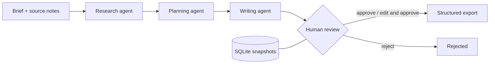

# Agentic Media OS

Infrastructure for AI-first creator and media businesses: explicit agents, reviewable workflows, durable state, and replaceable provider and integration boundaries.

**Early-stage open-source project · runnable MVP foundation · single local operator**

Creator operations need shared contracts and traceable state across research, planning, drafting, approval and delivery. This project starts with one small workflow for independent creators, podcast producers and media teams, before expanding into reusable infrastructure.

## What works today

- A CLI and authenticated FastAPI application run the same content workflow.
- Research extracts supplied source notes; planning and writing produce a structured draft with source IDs.
- SQLite stores workflow snapshots across restarts.
- A human explicitly approves, rejects, or edits and approves a draft. Version checks reject stale reviews.
- Only approved runs can be exported as structured JSON for future publishing adapters.
- Local execution and tests need no API keys, network or paid models after installation.

The shipped `LocalProvider` is a **deterministic extractive baseline**, not an LLM. It does not browse, discover sources, independently verify facts, or produce sophisticated prose. It demonstrates orchestration and approval without pretending an AI integration exists. Source IDs establish provenance, not truth or permission to publish.

## Quick start

Requires Python 3.12+ and Git. From the repository root:

```sh
python -m venv .venv
```

Activate with `source .venv/bin/activate` on macOS/Linux or `.venv\Scripts\Activate.ps1` in Windows PowerShell. Then:

```sh
python -m pip install -e ".[dev]"
amos run examples/brief.json
```

The result includes an `id`, `version: 2` and `status: pending_approval`. Read the draft and sources, then replace `WORKFLOW_ID` with the returned UUID:

```sh
amos show WORKFLOW_ID
amos review WORKFLOW_ID examples/review.json
amos export WORKFLOW_ID
```

The example review approves version 2. Use the current version for other runs; set `decision` to `reject` to decline. Approval is an editorial action, not an automatic step. See [getting started](docs/GETTING_STARTED.md) for edits, API requests, configuration and Docker.

## Architecture



CLI and API call `ContentWorkflow`. Agents validate outputs and citations. `ContentProvider` isolates generation; `RunStore` isolates persistence. Proposed knowledge and publishing ports are small typed contracts with no external adapter yet.

Python, Pydantic, FastAPI and SQLite keep this slice easy to inspect. Explicit synchronous orchestration fits three ordered steps. LangGraph, LangChain, PostgreSQL, n8n and MCP are deferred until requirements justify them. See [architecture](docs/ARCHITECTURE.md) and [decisions](docs/DECISIONS/0001-mvp-boundaries.md).

## Development

```sh
ruff check .
ruff format --check .
mypy src
pytest
```

CI runs these checks and builds the package. See [contributing](CONTRIBUTING.md) for reproducible dependency setup.

## Scope and next steps

No live LLM, web research, automatic publishing, semantic memory, background jobs, multi-user identity, tenant isolation or production hosting is implemented. Synchronous requests suit the fast local baseline. Interrupted runs can remain `running`; no recovery or retry exists. This is a foundation, not a production deployment.

The [roadmap](docs/ROADMAP.md) sequences provider evaluation, recovery and knowledge before external publishing and multi-workspace operation. [Agents](docs/AGENTS.md), [workflows](docs/WORKFLOWS.md), [memory](docs/MEMORY.md), and [integrations](docs/INTEGRATIONS.md) explain extension points.

## Contributing and technical collaboration

The system is actively being developed. We welcome experienced contributors and a potential founding technical collaborator to evolve architecture, agent orchestration, integrations, reliability and production infrastructure. Start with a focused issue and tested change; see [CONTRIBUTING.md](CONTRIBUTING.md). No funding, users or business traction are claimed here.

Read the [code of conduct](CODE_OF_CONDUCT.md), [security policy](SECURITY.md), [changelog](CHANGELOG.md), and [initial audit](docs/AUDIT.md). Licensed under [MIT](LICENSE).
