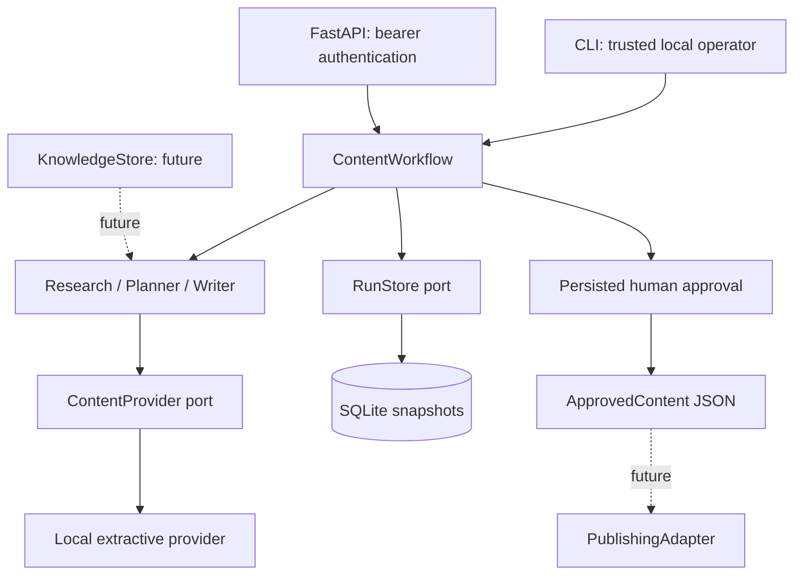

# Architecture

The deployment unit is one Python process and local SQLite, not a distributed platform.

## Components

`models.py` contains immutable domain contracts, bounds and state invariants. Tuple collections prevent accidental nested mutation. `agents.py` owns task validation and source references; `providers.py` owns generation. The only provider is extraction/templating, with no LLM prompts or dependencies.

`workflows.py` owns transitions and the export gate. CLI/API reuse it. `store.py` persists validated snapshots using parameterized SQL and optimistic versions. Connections open and close per operation, including API worker threads. Generation occurs outside short write transactions. Conditional updates prevent competing reviews from overwriting each other.

`memory.py` and `integrations.py` define future ports without dummy implementations. A Python model is not a security capability: future publishing entry points must fetch exports from persisted state rather than accept caller-forged approved payloads.

## Data flow

1. Validate a bounded brief and unique source IDs.
2. Persist running version 1.
3. Run research, plan and writer; validate schemas and citations.
4. Persist pending version 2 or failed with a fixed error code.
5. Human reads sources, limitations and draft; submits a review naming the expected version.
6. An atomic conditional update commits approval/rejection, retaining original and edited text.
7. Export reads approved persisted state. It has no external effects.

## Failure handling and observability

Provider/agent errors become durable failed runs without private exception text. Storage errors propagate separately and API maps them to 503. Application logs contain workflow IDs, versions and statuses, never notes, tokens or provider exception messages. Documented Uvicorn commands disable access logging. No tracing/metrics backend exists.

Execution is synchronous, with one generation attempt per invocation. Client retries can create additional runs. There is no create idempotency, automatic retry, cancellation, queue or crash recovery. Crashes can leave running records. Snapshots retain original/reviewed drafts, not an event history. Schema version 1 rejects unsupported future versions; migrations are needed before changing storage contracts.

## Security and scaling

API authentication serves a single operator, not multiple identities or tenants. Reviewer labels are self-reported. Health/schema are public; request bodies are capped at 256 KiB including streams. Notes are untrusted data, never executed or fetched as URLs. Plaintext SQLite needs filesystem permissions and intentional backup/retention.

Keep host binding on loopback. Remote deployment needs TLS, identity, authorization, ingress rate/size/deadline limits and monitoring. Before slow providers, add execution deadlines, worker attempt records and recovery. PostgreSQL should follow measured concurrency needs. Workspace scoping must cover every read/write before multi-creator hosting. A graph engine becomes useful when branching, parallel research and durable resumption justify its complexity.
