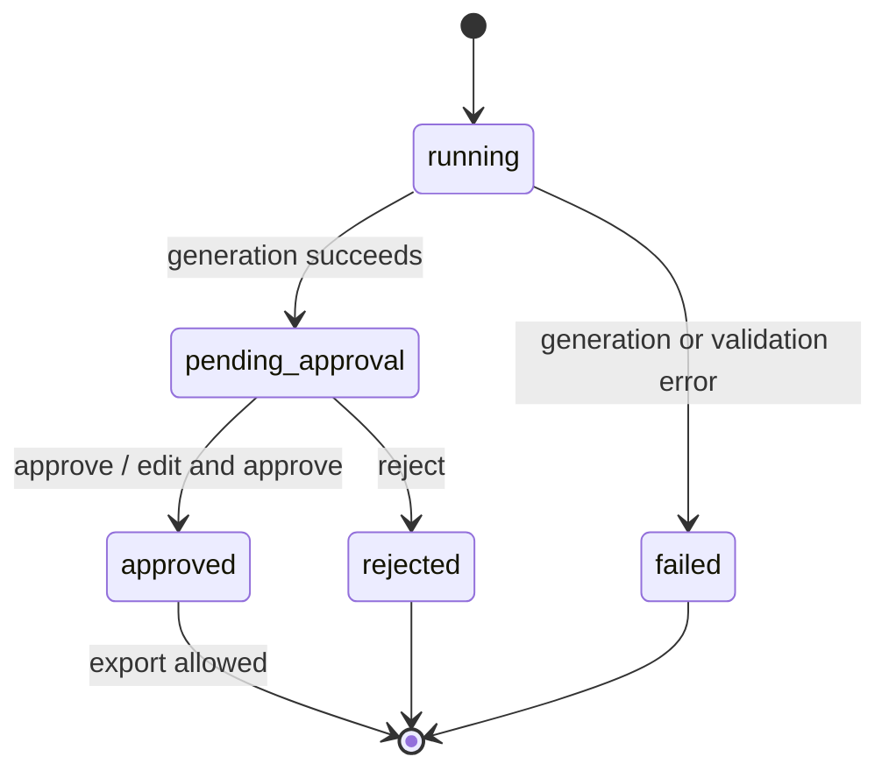

# Content workflow

ContentWorkflow.start persists before execution and returns the attempt. Version 1 is running; 2 is pending/failed; successful review creates 3. API returns 201 for the run resource even if generation fails. Inspect status/error_code.

Research retains source IDs and limitations. The local provider considers the first 1000 characters per note, performs no search/fact checking, and builds a basic editorial draft.

Review requires expected_version, reviewer label, decision and note. Approval may carry edited_draft; original text is retained and source IDs must exist. Provenance does not prove support for every sentence. Humans must check accuracy, attribution, rights and appropriateness. Reviewer names are self-reported, not authenticated identities.

No automatic/default approval exists. Rejected and failed runs cannot resume or export; start a new brief. Concurrent reviews conflict. Export returns the exact stored draft plus source/review metadata, without external calls.

There is no retry, create idempotency, worker dispatch or crash recovery. Review writes are atomic; generation is not one transaction. Trusted local file access bypasses application policy.
